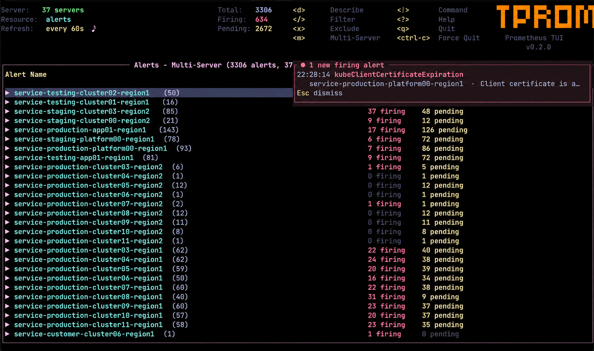

# tprom - Terminal UI for Prometheus

**tprom** provides a terminal UI to interact with your Prometheus servers. The aim of this project is to make it easier to navigate, observe, and manage your Prometheus data in the wild.

---

[](LICENSE)
[](https://www.rust-lang.org/)



---

## Features

- **10 Resource Views**: Targets, Alerts, Rules, Metrics, Labels, TSDB, Config, Info, Query, Servers
- **Interactive PromQL**: Execute queries with autocomplete, query history, and browse results in real-time
- **Graph Visualization**: Render PromQL range query results as terminal-based graphs
- **Multi-Server Management**: Save and switch between multiple Prometheus instances
- **Multi-Server Querying**: Query alerts or run PromQL across multiple servers simultaneously with tree-view results grouped by server
- **Authentication**: Bearer token and Basic auth support
- **Auto-Refresh**: Toggle periodic refresh with an adjustable interval (5s–10m), remembered between runs
- **New Alert Notifications**: When a critical alert starts firing, a notification stays on screen until you dismiss it and a sound plays (single or multi-server, respects exclusions)
- **Vim-Style Navigation**: `j/k`, `gg/G`, `/` search, `:` command palette
- **Describe Views**: Detailed drill-down for targets, alerts, rules, and metrics
- **Loading Animations**: Non-blocking background fetches with spinner overlays

---

## Installation

### Homebrew (macOS/Linux)

```bash
brew install huseyinbabal/tap/tprom
```

### Scoop (Windows)

```powershell
scoop bucket add huseyinbabal https://github.com/huseyinbabal/scoop-bucket
scoop install tprom
```

### Download Pre-built Binaries

Download the latest release from the [Releases page](https://github.com/huseyinbabal/tprom/releases/latest).

| Platform | Architecture | Download |
|----------|--------------|----------|
| **macOS** | Apple Silicon | `tprom-aarch64-apple-darwin.tar.gz` |
| **macOS** | Intel | `tprom-x86_64-apple-darwin.tar.gz` |
| **Linux** | x86_64 (musl) | `tprom-x86_64-unknown-linux-musl.tar.gz` |
| **Linux** | ARM64 (musl) | `tprom-aarch64-unknown-linux-musl.tar.gz` |
| **Windows** | x86_64 | `tprom-x86_64-pc-windows-msvc.zip` |

```bash
# Example: macOS Apple Silicon
curl -sL https://github.com/huseyinbabal/tprom/releases/latest/download/tprom-aarch64-apple-darwin.tar.gz | tar xz
sudo mv tprom /usr/local/bin/
```

### Using Cargo

```bash
cargo install tprom
```

### Using Docker

```bash
# Connect to a Prometheus server
docker run --rm -it ghcr.io/huseyinbabal/tprom --url http://prometheus:9090

# Keep saved servers between runs
docker run --rm -it -v ~/.config/tprom:/root/.config/tprom ghcr.io/huseyinbabal/tprom
```

### From Source

```bash
git clone https://github.com/huseyinbabal/tprom.git
cd tprom
cargo install --path .
```

---

## Usage

```bash
# Connect to a Prometheus server
tprom --url http://localhost:9090

# With bearer token authentication
tprom --url https://prometheus.example.com --token <token>

# With basic authentication
tprom --url https://prometheus.example.com --user admin --password secret

# Auto-refresh every 30 seconds for this session
tprom --refresh 30

# Use a louder notification sound for this session
tprom --notification-sound siren

# Launch without arguments to use saved servers or add a new one
tprom
```

---

## Key Bindings

| Key | Action |
|-----|--------|
| `:` | Open command palette |
| `j` / `k` | Navigate up/down |
| `gg` / `G` | Go to top / bottom |
| `d` / `Enter` | Describe selected item |
| `/` | Filter / search |
| `n` / `N` | Next / previous search match (config view) |
| `R` | Refresh current view |
| `a` | Toggle auto-refresh |
| `+` / `-` | Increase / decrease auto-refresh interval |
| `b` | Toggle sound on new critical alerts |
| `Esc` | Dismiss alert notifications |
| `m` | Multi-server select (alerts & query views) |
| `Tab` | Switch panels (labels, query) |
| `q` | Quit |
| `Ctrl-C` | Force quit |

### Server Management (`:servers`)

| Key | Action |
|-----|--------|
| `c` | Connect to selected server |
| `a` | Add new server |
| `D` | Delete selected server |

### Query View (`:query`)

| Key | Action |
|-----|--------|
| `Enter` | Execute query |
| `Up` / `Down` | Browse query history / autocomplete |
| `Tab` | Switch between input and results |
| `v` | Visualize as graph (range query) |
| `d` | Describe selected result |
| `m` | Multi-server query |
| `Esc` | Switch to results panel |

### Multi-Server Results

| Key | Action |
|-----|--------|
| `Right` / `l` | Expand server group |
| `Left` / `h` | Collapse server group |
| `j` / `k` | Navigate rows |

Results start collapsed showing server names with result counts. Use `Right` arrow to expand a group and see individual results.

### Multi-Server Select Modal

| Key | Action |
|-----|--------|
| `j` / `k` | Navigate server list |
| `Space` | Toggle server selection |
| `Enter` | Confirm and fetch from selected servers |
| `Esc` | Cancel |

---

## Resources

Press `:` to open the command palette. Available resources:

| Command | Description |
|---------|-------------|
| `:targets` | Scrape targets and health status |
| `:alerts` | Firing and pending alerts |
| `:rules` | Recording and alerting rules |
| `:metrics` | Browse metric names with metadata |
| `:labels` | Browse label names and values |
| `:tsdb` | TSDB cardinality and head stats |
| `:config` | View Prometheus YAML configuration |
| `:info` | Runtime, build info, and flags |
| `:query` | Interactive PromQL query REPL |
| `:servers` | Manage server connections |

---

## Configuration

Settings are saved to `~/.config/tprom/config.yaml` on Linux and `~/Library/Application Support/tprom/config.yaml` on macOS:

```yaml
servers:
  - name: local
    url: http://localhost:9090
    auth:
      type: none
  - name: production
    url: https://prometheus.prod.example.com
    auth:
      type: bearer
      token: <token>
  - name: staging
    url: https://prometheus.staging.example.com
    auth:
      type: basic
      username: admin
      password: secret
alert_exclusions:
  - pattern: Watchdog
    servers: []
alert_sound: true          # sound when a new alert starts firing (toggle: b)
alert_sound_name: default  # default | chime | alarm | siren | klaxon | macOS sound name (Sosumi, Basso, ...) | /path/to/file
alert_sound_repeat: 1      # times the sound is played per notification (1-10)
notify_severities:         # severity labels that notify; [] = all
  - critical
auto_refresh: false        # start with auto-refresh on (toggle: a)
refresh_interval_secs: 60  # auto-refresh interval (adjust: + / -)
```

A notification is raised when an alert **name** starts firing on a server with a matching `severity` label. More instances of an alert name that is already firing (for example another failed job) don't notify again, and neither does an alert that resolves and fires again within 5 minutes. The first fetch of each server only records a baseline. If a server can't be reached, its last known alerts are kept, so it doesn't notify for all of them when it comes back. Notifications stay in the top-right corner until you press `Esc`. Sounds work best with auto-refresh on (`a`). The `default` sound is the system "Glass" sound on macOS and the built-in `chime` on Linux and Windows. The built-in sounds (`chime`, `alarm`, `siren`, `klaxon`) are embedded in the binary and generated by [`scripts/generate-sounds.py`](scripts/generate-sounds.py), so they are covered by the project's MIT license. They are played with `afplay` on macOS, `paplay`/`pw-play`/`aplay` on Linux and PowerShell on Windows. When no player is available, tprom rings the terminal bell.

---

## Contributing

Contributions are welcome! Please feel free to open issues or submit pull requests.

---

## Acknowledgments

- Inspired by [k9s](https://github.com/derailed/k9s) - the awesome Kubernetes CLI
- Inspired by [taws](https://github.com/huseyinbabal/taws) - Terminal UI for AWS
- Inspired by [tredis](https://github.com/huseyinbabal/tredis) - Terminal UI for Redis
- Built with [Ratatui](https://github.com/ratatui-org/ratatui) - Rust TUI library

---

## License

This project is licensed under the MIT License - see the [LICENSE](LICENSE) file for details.

---

<p align="center">
  Made with care for the Prometheus community
</p>
